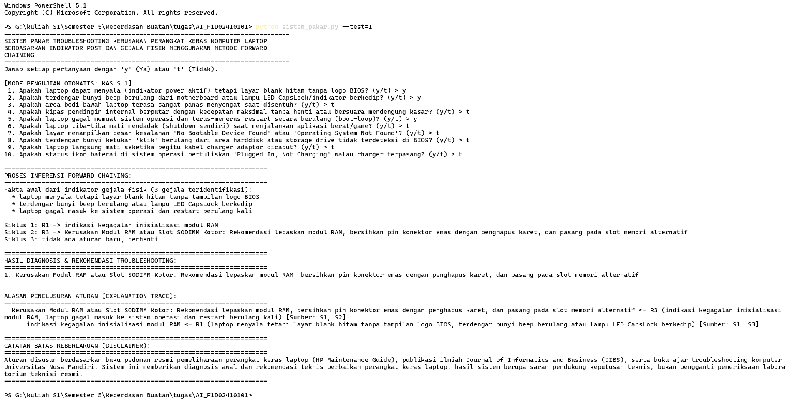
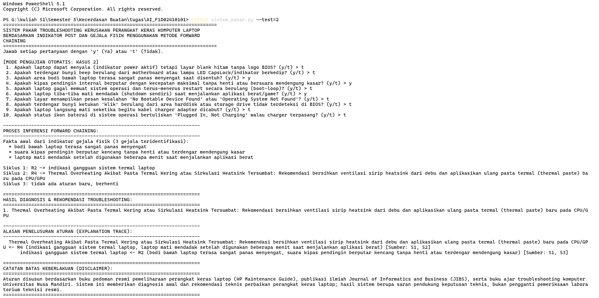
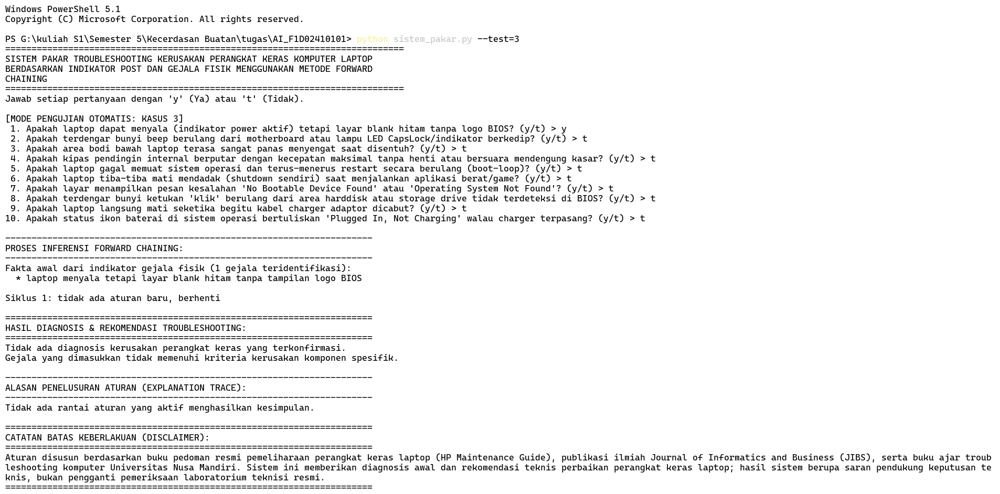

# Sistem Pakar Troubleshooting Kerusakan Perangkat Keras Komputer Laptop Berdasarkan Indikator POST dan Gejala Fisik Menggunakan Metode Forward Chaining

---

## 1. Identitas Mahasiswa
* **Nama** : Ajriya Danuarta
* **NIM** : F1D02410101
* **Mata Kuliah** : Kecerdasan Buatan
* **Dosen Pengampu** : Pahrul Irfan, S.Kom., M.Kom.

---

## 2. Topik & Cara Menjalankan Program

### Topik & Judul
**Judul Sistem Pakar:**  
*Sistem Pakar Troubleshooting Kerusakan Perangkat Keras Komputer Laptop Berdasarkan Indikator POST dan Gejala Fisik Menggunakan Metode Forward Chaining*

**Deskripsi Singkat:**  
Sistem pakar ini dirancang untuk mendeteksi dan mendiagnosis secara dini kerusakan perangkat keras (*hardware*) pada komputer jinjing (*laptop*) berdasarkan indikator pengujian daya awal (*Power-On Self-Test* / POST, seperti kode beep dan kedipan LED), perilaku sistem operasi, serta gejala fisik yang teramati (suhu termal, perilaku kipas, dan media penyimpanan), serta memberikan rekomendasi langkah perbaikan teknis yang tepat.

### Spesifikasi Bahasa & Lingkungan
* **Bahasa Pemrograman**: Python
* **Versi Minimum**: Python 3.8+ (Diuji pada Python 3.12.7)
* **Pustaka (*Dependencies*)**: Pustaka standar bawaan Python (`json`, `sys`, `os`, `textwrap`), tanpa perlu menginstal dependensi eksternal (*zero external dependencies*).

### Cara Menjalankan Program
1. Buka terminal atau Command Prompt dan arahkan ke folder ini:
   ```cmd
   cd /d "AI-F1D02410101"
   ```
2. **Mode Interaktif (Tanya Jawab Langsung)**:
   ```cmd
   python sistem_pakar.py
   ```
   Jawab setiap pertanyaan gejala dengan mengetikkan `y` (Ya) atau `t` (Tidak), lalu tekan Enter.
3. **Mode Pengujian Otomatis (Kasus Uji 1, 2, atau 3)**:
   ```cmd
   # Menjalankan Kasus 1 (Diagnosis Kerusakan Modul RAM / Slot SODIMM)
   python sistem_pakar.py --test=1

   # Menjalankan Kasus 2 (Diagnosis Thermal Overheating & Pasta Kering)
   python sistem_pakar.py --test=2

   # Menjalankan Kasus 3 (Kasus Negatif / Tanpa Kerusakan Terkonfirmasi)
   python sistem_pakar.py --test=3
   ```

---

## 3. Daftar Sumber & Tabel Aturan

### A. Daftar Sumber Pengetahuan Resmi (3 Referensi)
1. **[S1] Dokumentasi Resmi Vendor (HP Inc. Official Documentation)**
   * **Judul**: *HP Maintenance and Service Guide: Troubleshooting and Maintenance*
   * **Penerbit**: HP Inc. Global Support Services
   * **URL**: [https://kaas.hpcloud.hp.com/pdf-public/pdf_12632864_en-US-1.pdf](https://kaas.hpcloud.hp.com/pdf-public/pdf_12632864_en-US-1.pdf)
   * **Tanggal Akses**: 14 November 2026
   * **Kaidah yang Diambil**: Standar kode kedipan LED/beep indikator POST kegagalan memori (*memory failure blink code*), prosedur penanganan *thermal shutdown*, dan verifikasi diagnostik *storage failure*.

2. **[S2] Jurnal Ilmiah Komputer (Journal of Informatics and Business)**
   * **Judul**: *Sistem Pakar Deteksi Kerusakan Laptop Dengan Metode Forward Chaining*
   * **Penulis**: Murjiyanto Krisno, Yohanes Umbu Lado, Fransiskus Radho
   * **Penerbit**: *Journal of Informatics and Business (JIBS)*, Vol. 1, No. 2 (2023), hal. 45–54
   * **DOI / URL**: [https://jurnal.ittc.web.id/index.php/jibs/article/view/222](https://jurnal.ittc.web.id/index.php/jibs/article/view/222)
   * **Tanggal Akses**: 14 November 2026
   * **Kaidah yang Diambil**: Pemetaan gejala fisik ke komponen perangkat keras (RAM, pasta prosesor, baterai, media penyimpanan) serta perancangan aturan inferensi maju (*forward chaining*).

3. **[S3] Buku Ajar Institusi Pendidikan Tinggi (Universitas Nusa Mandiri)**
   * **Judul**: *Buku Ajar Troubleshooting Komputer*
   * **Penerbit**: Program Studi Teknologi Komputer, Fakultas Teknologi Informasi, Universitas Nusa Mandiri
   * **URL**: [https://repository.nusamandiri.ac.id/repo/files/235574/download/Buku-Troubleshooting-Komputer-Full.pdf](https://repository.nusamandiri.ac.id/repo/files/235574/download/Buku-Troubleshooting-Komputer-Full.pdf)
   * **Tanggal Akses**: 14 November 2026
   * **Kaidah yang Diambil**: Prosedur pembersihan pin konektor emas SODIMM dengan isolator karet, penyebab siklus panas berlebih (*overheat thermal throttle*), dan analisis *bad sector* pada storage drive.

---

### B. Tabel Aturan IF-THEN (*Knowledge Base*)

Basis pengetahuan disimpan dalam file `kb_laptop.json` dengan struktur berikut:

| ID | Premis Kondisi (IF) | Mode | Kesimpulan / Hasil (THEN) | Sumber | Rantai (*Chaining*) |
| :---: | :--- | :---: | :--- | :---: | :--- |
| **R1** | • laptop menyala tetapi layar blank hitam tanpa tampilan logo BIOS<br>• terdengar bunyi beep berulang atau lampu LED CapsLock berkedip | **dan** *(AND)* | `indikasi kegagalan inisialisasi modul RAM` | S1, S3 | Menghasilkan fakta perantara (*intermediate fact*) |
| **R2** | • bodi bawah laptop terasa sangat panas menyengat<br>• suara kipas pendingin berputar kencang tanpa henti atau terdengar mendengung kasar | **dan** *(AND)* | `indikasi gangguan sistem termal laptop` | S1, S3 | Menghasilkan fakta perantara (*intermediate fact*) |
| **R3** | • **indikasi kegagalan inisialisasi modul RAM** *(hasil R1)*<br>• laptop gagal masuk ke sistem operasi dan restart berulang kali | **dan** *(AND)* | **Kerusakan Modul RAM atau Slot SODIMM Kotor: Rekomendasi lepaskan modul RAM, bersihkan pin konektor emas dengan penghapus karet, dan pasang pada slot memori alternatif** | S1, S2 | **Kesimpulan Akhir 1** *(Chaining dari R1)* |
| **R4** | • **indikasi gangguan sistem termal laptop** *(hasil R2)*<br>• laptop mati mendadak setelah digunakan beberapa menit saat menjalankan aplikasi berat | **dan** *(AND)* | **Thermal Overheating Akibat Pasta Termal Kering atau Sirkulasi Heatsink Tersumbat: Rekomendasi bersihkan ventilasi sirip heatsink dari debu dan aplikasikan ulang pasta termal (thermal paste) baru pada CPU/GPU** | S1, S2 | **Kesimpulan Akhir 2** *(Chaining dari R2)* |
| **R5** | • layar menampilkan pesan error No Bootable Device Found atau Operating System Not Found<br>• terdengar bunyi ketukan klik berulang pada area storage atau drive tidak terbaca di BIOS | **atau** *(OR)* | **Kerusakan Media Penyimpanan (Storage Drive Bad Sector / Rusak): Rekomendasi periksa pemasangan konektor SATA-NVMe, uji diagnostik SMART drive, dan siapkan penggantian drive SSD/HDD** | S1, S3 | **Kesimpulan Akhir 3** |
| **R6** | • laptop langsung mati seketika saat charger adaptor dilepas<br>• indikator baterai pada sistem operasi bertuliskan Plugged In Not Charging | **atau** *(OR)* | **Degradasi Sel Baterai atau Gangguan Sirkuit Pengisian Daya: Rekomendasi lakukan kalibrasi baterai atau rencanakan penggantian unit baterai laptop** | S1, S2 | **Kesimpulan Akhir 4** |

---

## 4. Metode Inferensi yang Dipilih & Alasannya

Metode yang dipilih adalah **Forward Chaining (FC)** (*data-driven reasoning*).

### Alasan Pemilihan Forward Chaining:
1. **Sesuai Pendekatan Diagnosis Teknisi Lapangan**:  
   Saat menganalisis kerusakan laptop, teknisi atau pengguna memulai pengamatan dari gejala fisik dan indikator hardware yang terdeteksi (apakah ada kode kedip LED, suara beep, suhu panas, atau pesan POST BIOS). Pendekatan *data-driven* mengumpulkan fakta-fakta ini terlebih dahulu untuk kemudian ditarik ke kesimpulan komponen yang rusak.
2. **Mendukung Inferensi Berantai Bertingkat (*Chaining*)**:  
   Aturan R1 dan R2 menyimpulkan masalah fungsional awal (`indikasi kegagalan inisialisasi modul RAM` dan `indikasi gangguan sistem termal laptop`), kemudian aturan lanjutan (R3 dan R4) mengombinasikannya dengan gejala kegagalan boot atau shutdown mendadak untuk menyimpulkan penyebab kerusakan fisik secara spesifik.
3. **Penyajian Alasan (*Explanation Trace*) yang Transparan**:  
   Pengguna dapat melihat urutan siklus penalaran (`Siklus 1 -> Siklus 2 -> ...`) beserta premis pendukungnya, sehingga solusi teknis yang direkomendasikan dapat dipertanggungjawabkan keabsahannya.

---

## 5. Tiga Kasus Uji & Screenshot Hasil Eksekusi

### Ringkasan Kasus Uji
| # | Skenario Gejala Bernilai "Ya" | Kesimpulan yang Diharapkan | Status Hasil |
| :-: | :--- | :--- | :-: |
| **1** | • Layar blank hitam tanpa logo BIOS<br>• Bunyi beep berulang / LED CapsLock berkedip<br>• Gagal masuk OS & restart berulang | **Kerusakan Modul RAM atau Slot SODIMM Kotor: Rekomendasi lepaskan modul RAM, bersihkan pin konektor emas dengan penghapus karet, dan pasang pada slot memori alternatif** | **Berhasil (Positif)** |
| **2** | • Bodi bawah sangat panas menyengat<br>• Kipas pendingin berputar kencang tanpa henti<br>• Mati mendadak saat menjalankan aplikasi berat | **Thermal Overheating Akibat Pasta Termal Kering atau Sirkulasi Heatsink Tersumbat: Rekomendasi bersihkan ventilasi sirip heatsink dari debu dan aplikasikan ulang pasta termal (thermal paste) baru pada CPU/GPU** | **Berhasil (Positif)** |
| **3** | • Layar blank hitam saja *(gejala tunggal tanpa beep/LED dan tanpa restart loop)* | **Tidak ada diagnosis kerusakan perangkat keras yang terkonfirmasi** *(gejala tidak memenuhi kriteria kerusakan spesifik)* | **Berhasil (Kasus Negatif)** |

---

### Screenshot Kasus 1: Kerusakan Modul RAM / Slot SODIMM
Gejala layar blank disertai kedipan kode LED dan restart loop memicu aturan R1 dan R3 secara berantai:



---

### Screenshot Kasus 2: Thermal Overheating & Pasta Kering
Gejala suhu bodi panas menyengat, putaran kipas maksimal, dan shutdown mendadak saat beban kerja tinggi memicu aturan R2 dan R4 secara berantai:



---

### Screenshot Kasus 3: Kasus Negatif (Tanpa Kesimpulan)
Pengguna hanya memasukkan fakta layar blank tanpa ada indikasi beep/LED, suara kipas, maupun kegagalan sistem. Mesin forward chaining berhenti pada siklus pertama:



---

## 6. Batas Keberlakuan (*Disclaimer*)

Basis pengetahuan dan aturan sistem pakar ini dirumuskan berdasarkan buku pedoman pemeliharaan resmi dari HP Inc. (*HP Maintenance and Service Guide*), publikasi ilmiah *Journal of Informatics and Business* (JIBS), serta buku ajar troubleshooting komputer dari Program Studi Teknologi Komputer Universitas Nusa Mandiri. Sistem ini dirancang untuk diagnosis awal dan panduan tindakan perbaikan perangkat keras laptop secara mandiri bagi pengguna awam dan teknisi pemula. Rekomendasi teknis yang dihasilkan bersifat **saran pendukung keputusan (*decision support*)**, dan pembongkaran fisik komponen laptop harus tetap dilakukan dengan kehati-hatian tinggi serta memperhatikan prosedur pelepasan muatan listrik statis (*electrostatic discharge* / ESD) agar tidak membatalkan garansi resmi perangkat.

---

## 7. Penggunaan Alat Bantu AI
* **Status Penggunaan AI**: **Digunakan sebagai alat bantu belajar**.
* **Alat yang Digunakan**: Google DeepMind Agentic AI (Antigravity).
* **Rincian Pemanfaatan**:
  1. Menelaah format dan standar penugasan sistem pakar Tugas 5 Kecerdasan Buatan.
  2. Membantu penelusuran manual servis pabrikan resmi (HP) dan buku ajar troubleshooting komputer perguruan tinggi.
  3. Menyusun struktur aturan basis pengetahuan JSON (`kb_laptop.json`) dengan mekanisme inferensi berantai.
* **Pertanggungjawaban**: Seluruh konsep aturan, logika program, dan dokumentasi telah diverifikasi, dipahami secara mandiri, dan dapat dijelaskan di hadapan dosen pengampu mata kuliah.
